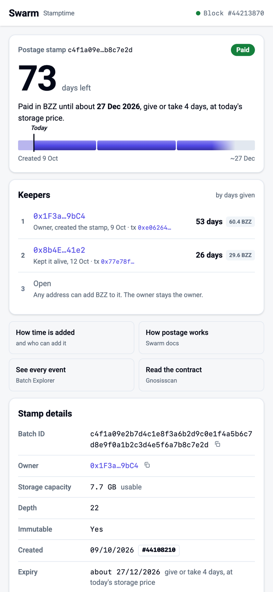
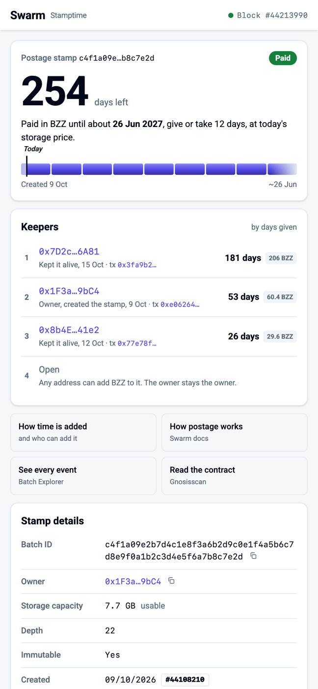
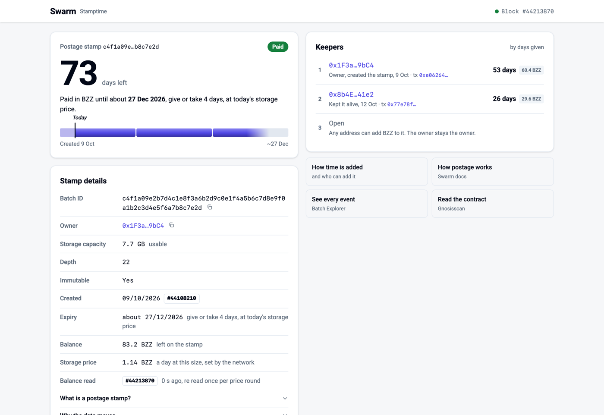
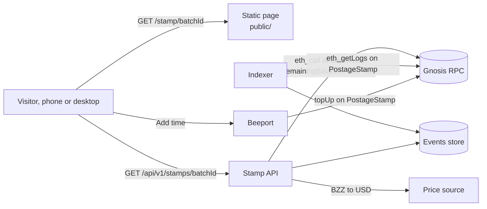

# Stamptime

A public page for one Swarm postage stamp. It answers one question for anyone who lands on it, **how long is this paid for?**, shows who has been keeping it alive, and offers a way for anyone to interact with the stamp.

Its ideal place is `ethswarm.org/stamp/<batchId>`, served by the Swarm Foundation as a service, for any stamp on the network. Any other place where Swarm's tooling is presented works just as well.

It stands on the great work of [Batch Explorer](https://batch-explorer.github.io/): the page borrows its look, and sends anyone who wants every event of a batch there.

<p>
  
  
</p>



---

## The short version

- **The page is done.** It lives in `public/`: one HTML file, one CSS file, one JS file. No build step, no framework, no dependencies.
- **It renders everything from one JSON document per stamp.** The bar, the ranking, the four states, the Add time sheet, waiting for a top up to land: all of that is already in `public/stamp.js`.
- **What we need from you is the data and a place to serve it:**
  1. An endpoint `GET /api/v1/stamps/{batchId}` that returns that JSON. The contract is [`api/stamp.schema.json`](api/stamp.schema.json), with one example per state in [`public/examples/`](public/examples/).
  2. Somewhere on ethswarm.org that serves `public/` at `/stamp/{batchId}`.
- **Everything you need to compute the JSON from Gnosis** is in [How to compute each field](#how-to-compute-each-field), with viem snippets.
- **A few decisions are still open** and are listed in [Open questions](#open-questions). None of them blocks starting.

If you read only one more section, read [The API contract](#the-api-contract).

---

## See it running in one minute

```bash
git clone <this repo> && cd stamptime
python3 -m http.server 8080 --directory public
```

Then open one of these. The demo reads `public/examples/<name>.json` instead of the API and shows a bar to switch between states.

| URL | What you see |
|---|---|
| http://localhost:8080/?demo=active | A paid stamp, 73 days left, two keepers |
| http://localhost:8080/?demo=topped | The same stamp after someone added six months |
| http://localhost:8080/?demo=expiring | 9 days left, the pill turns amber |
| http://localhost:8080/?demo=expired | The balance ran out, Add time is disabled |
| http://localhost:8080/?demo=not_found | An id that was never created |
| http://localhost:8080/?demo=loading | The page while it waits for the API |
| http://localhost:8080/?demo=error | The API did not answer |

In the `active` demo, press **Take it** or **Add time**, then **Continue to Beeport**. The page shows the waiting state, then plays the top up arriving: the new months add up one by one at the end of the bar and you appear at the top of the ranking. In production the same code opens Beeport in a new tab and polls the API until the new top up shows up.

Add `&bare=1` to hide the demo bar (that is how the screenshots above were taken).

---

## What the page shows, and where each number comes from

| On screen | JSON field | Source on chain |
|---|---|---|
| **73** days left | `expiry.time`, `chain.blockTime` | `remainingBalance(id) / lastPrice()` blocks, 5 s each |
| Paid until about **27 Dec 2026**, give or take 4 days | `expiry.time`, `expiry.earliest`, `expiry.latest` | same, with the lowest and highest price of the last 30 days |
| Pill: Paid, Expiring soon, Expired | `status`, plus the page rule "14 days or less" | `remainingBalance`, contract state, `BatchCreated` history |
| The bar: one block per month, from creation to the end | `created.time`, `expiry.*`, `chain.blockTime` | `BatchCreated` block time, the expiry above |
| Keepers ranking, days and BZZ per address, dollars in full mode | `contributions[]` | `BatchCreated` and every `BatchTopUp`, payer from the transaction |
| "Keep it alive: 30 days from about $1.37" | `pricing.usdPerDay` | `lastPrice()`, depth, a BZZ to USD rate |
| Add time sheet: ≈ 34.2 BZZ per option, ≈ $1.37 underneath | `pricing.bzzPerDay`, `pricing.usdPerDay` | `lastPrice()` and depth; the dollars add a BZZ to USD rate |
| Batch ID, owner, depth, immutable | `batchId`, `owner`, `depth`, `immutable` | `BatchCreated`, `BatchDepthIncrease` |
| Storage capacity, 7.7 GB usable | `capacity` | effective volume table for the depth (not on chain) |
| Created 09/10/2026, #44108210 | `created.*` | `BatchCreated` log |
| Balance, 83.2 BZZ left on the stamp | `pricing.bzzPerDay` times the days from `chain.blockTime` to `expiry.time` | `remainingBalance(id)` x 2^depth / 1e16 |
| Storage price, 1.14 BZZ a day at this size | `pricing.bzzPerDay` | `lastPrice()` and depth |
| Block #44213870, balance read N s ago | `chain.block`, `chain.blockTime` | the block both reads were pinned to |
| Footer: RPC and contract | `chain.rpc`, `chain.contract` | your configuration |

BZZ is the unit of the page. The headline says the stamp is paid in BZZ, each keeper shows the BZZ they put on it, Stamp details show Balance and Storage price in BZZ so anyone can divide one by the other and get the expiry back, and the Add time sheet shows each duration in BZZ with the dollar equivalent underneath. Dollars never appear without the BZZ they estimate, and the page never shows PLUR.

---

## Architecture



**Why an API and not chain reads from the browser.** The page could in principle read Gnosis directly, but in practice it would need:

- the full event history of a batch, which means `eth_getLogs` over millions of blocks, and public RPCs cap log ranges;
- one extra `eth_getTransaction` per top up, because `BatchTopUp` carries no payer;
- the price history for the date range and for the days each top up bought;
- a USD rate, which is off chain;
- a way to tell an expired batch from one that never existed, after the contract has removed it from state.

That is a lot of RPC traffic per visitor, and a link shared widely can send hundreds of visitors at the same time. A small indexer plus one cached endpoint makes all of this one request.

Anything works as the stack. The only interface the page cares about is the JSON.

---

## The API contract

```
GET /api/v1/stamps/{batchId}
```

- `batchId`: 64 hex characters, with or without `0x`, any case. Normalise to lower case without `0x` in the response.
- Always answer **200** with a JSON body, including for a stamp that does not exist (`{"batchId": "<the id>", "status": "not_found"}`). The page also accepts a 404 with that same body, but any other 404 is treated as "the API is not where I expected", which shows the error state, not "no stamp".
- The page checks each document against this contract before drawing it. One that does not match the schema, or carries another `batchId` than the one asked for, shows the error state, with the reason in the browser console.
- `400` for a malformed id. The page validates the id before calling, so this should not happen from the page.
- Headers: `Content-Type: application/json`, `Access-Control-Allow-Origin: *` (the badge will call it from other sites), `Cache-Control: public, max-age=15`.

Keep the cache short: after a top up the page polls every 10 seconds and the visitor is watching.

### Statuses

| `status` | Meaning | What the page does |
|---|---|---|
| `active` | The batch has balance left | Number, bar, ranking, Add time enabled. Shows "Expiring soon" when 14 days or less remain (page rule) |
| `expired` | A `BatchCreated` exists for this id, but the balance is zero or the batch was removed from state | Muted bar, "Ran out around …", Add time disabled, ranking kept as a record |
| `not_found` | No `BatchCreated` was ever emitted for this id on the current PostageStamp | "No stamp with this id", link to Batch Explorer |

### Fields

The full schema with descriptions is [`api/stamp.schema.json`](api/stamp.schema.json). Here is [`public/examples/active.json`](public/examples/active.json):

```json
{
  "batchId": "c4f1a09e2b7d4c1e8f3a6b2d9c0e1f4a5b6c7d8e9f0a1b2c3d4e5f6a7b8c7e2d",
  "status": "active",
  "chain": {
    "id": 100,
    "contract": "0x45a1502382541Cd610CC9068e88727426b696293",
    "rpc": "rpc.gnosis.gateway.fm",
    "block": 44213870,
    "blockTime": "2026-10-15T12:00:00Z"
  },
  "owner": "0x1F3a5c0E7b2D4a9f8E6c1B3d5F7a9C0e2B4d9bC4",
  "depth": 22,
  "immutable": true,
  "capacity": "7.7 GB",
  "created": { "time": "2026-10-09T09:14:25Z", "block": 44108210, "tx": "0xe062…eaca1" },
  "expiry": {
    "time": "2026-12-27T12:00:00Z",
    "earliest": "2026-12-23T12:00:00Z",
    "latest": "2026-12-31T12:00:00Z",
    "lastBlock": null
  },
  "pricing": { "bzzPerDay": 1.14, "usdPerDay": 0.0456 },
  "contributions": [
    { "kind": "created", "address": "0x1F3a…9bC4", "time": "2026-10-09T09:14:25Z", "block": 44108210, "tx": "0xe062…", "days": 53, "usd": 2.5 },
    { "kind": "topup",   "address": "0x8b4E…41e2", "time": "2026-10-12T17:41:05Z", "block": 44166123, "tx": "0x77e7…", "days": 26, "usd": 1.2 }
  ]
}
```

(Hashes and addresses shortened here; the files have them in full. The example values are illustrative, the contract address is the real one.)

| Field | Notes |
|---|---|
| `chain.block`, `chain.blockTime` | Pin **both** live reads (`remainingBalance` and `lastPrice`) to the same block, and send that block's timestamp. The page uses `blockTime` as "now". |
| `owner` | The batch owner. The ranking labels this address **Owner**, whoever paid for the `BatchCreated`. |
| `expiry.time` | Most likely end, always present for `active`. For `expired`, when it ran out, or `null` if you cannot reconstruct it. |
| `expiry.earliest`, `expiry.latest` | The range shown as "give or take". `null` when expired. The page also fades the end of the bar across it. |
| `pricing.bzzPerDay` | Cost of one more day for the whole stamp at today's price, in BZZ. From the chain alone. Shown in Stamp details as the Storage price and, times the days left, as the Balance, and in the Add time sheet. |
| `pricing.usdPerDay` | The same in USD. `null` hides the "from about $" line and the dollars in the Add time sheet, which then shows BZZ alone. The keepers' dollars come from each `contributions[].usd`. |
| `contributions[]` | One entry per event that paid for time, oldest first: the `BatchCreated`, then each `BatchTopUp`. Do not group them. The page groups by address into keepers. |
| `contributions[].days` | Days of storage that payment bought, at the price in force at its block. Fractions are fine. |
| `contributions[].usd` | Value of that payment at the time, or `null`. |
| `contributions[].bzz` | BZZ that payment put on the stamp (the event amount divided by 1e16), or `null`. Shown as a chip next to the keeper's days. |

---

## How to compute each field

### Constants

| | |
|---|---|
| Chain | Gnosis, chain id `100` |
| PostageStamp contract | `0x45a1502382541Cd610CC9068e88727426b696293` (the one Batch Explorer reads today; confirm before shipping) |
| Block time | 5 seconds, so 17,280 blocks a day |
| Price unit | PLUR per chunk per block. `lastPrice()` on PostageStamp, or `currentPrice()` on PriceOracle |
| Price changes | At most once per round of 152 blocks (about 12.7 minutes), emitted as `PriceUpdate(price)` by PostageStamp |
| PLUR per BZZ | 1e16 |
| Chunks in a batch | `2 ** depth` |

Sources: [PostageStamp.sol](https://github.com/ethersphere/storage-incentives/blob/master/src/PostageStamp.sol), [PriceOracle.sol](https://github.com/ethersphere/storage-incentives/blob/master/src/PriceOracle.sol), [Postage stamp batches in the docs](https://docs.ethswarm.org/docs/develop/tools-and-features/buy-a-stamp-batch).

### ABI you need

```ts
import { createPublicClient, http, parseAbi, parseAbiItem } from 'viem'
import { gnosis } from 'viem/chains'

export const POSTAGE_STAMP = '0x45a1502382541Cd610CC9068e88727426b696293'

export const abi = parseAbi([
  'function remainingBalance(bytes32 batchId) view returns (uint256)',
  'function lastPrice() view returns (uint64)',
  'function currentTotalOutPayment() view returns (uint256)',
])
export const BatchCreated = parseAbiItem('event BatchCreated(bytes32 indexed batchId, uint256 totalAmount, uint256 normalisedBalance, address owner, uint8 depth, uint8 bucketDepth, bool immutableFlag)')
export const BatchTopUp = parseAbiItem('event BatchTopUp(bytes32 indexed batchId, uint256 topupAmount, uint256 normalisedBalance)')
export const BatchDepthIncrease = parseAbiItem('event BatchDepthIncrease(bytes32 indexed batchId, uint8 newDepth, uint256 normalisedBalance)')
export const PriceUpdate = parseAbiItem('event PriceUpdate(uint256 price)')

export const client = createPublicClient({ chain: gnosis, transport: http('https://rpc.gnosis.gateway.fm') })
```

The contract also exposes the batch struct through its `batches(bytes32)` mapping (`owner, depth, bucketDepth, immutableFlag, normalisedBalance, lastUpdatedBlockNumber`). Check the exact getter in the verified ABI on Gnosisscan if you want it; everything below works from events alone.

### 1. The live part: expiry and range

```ts
const id = `0x${batchId}` as const
const block = await client.getBlock()                         // pin both reads to one block
const at = { blockNumber: block.number }

let remaining: bigint
try {
  remaining = await client.readContract({ address: POSTAGE_STAMP, abi, functionName: 'remainingBalance', args: [id], ...at })
} catch {
  remaining = 0n                                              // removed from state: see step 4
}
const price = await client.readContract({ address: POSTAGE_STAMP, abi, functionName: 'lastPrice', ...at })

const secondsLeft = Number(remaining / price) * 5
const expiry = new Date((Number(block.timestamp) + secondsLeft) * 1000)
```

For the range, take the lowest and highest `PriceUpdate` price of the last 30 days (about 518,400 blocks; your indexer already has them):

```ts
const earliest = Number(block.timestamp) + Number(remaining / maxPrice30d) * 5   // price up, ends sooner
const latest   = Number(block.timestamp) + Number(remaining / minPrice30d) * 5   // price down, lasts longer
```

If you do not have the history yet, a fixed band of plus or minus 5 % of the time left is an acceptable first version. Say so in a comment; the page copy says "the range uses the lowest and highest price of the last 30 days", so update that sentence in `index.html` if you ship the band.

### 2. The history: created and contributions

Index these PostageStamp events from the contract's deployment block, filtered by `batchId` where the event has it:

- `BatchCreated`: owner, depth, bucket depth, immutable flag, `totalAmount`.
- `BatchTopUp`: `topupAmount`.
- `BatchDepthIncrease`: new depth (a dilution).
- `PriceUpdate`: the price history, needed for every `days` value and for the range.

Then, per event:

```ts
// price in force at a block: the last PriceUpdate at or before it
// depth at a block: from BatchCreated, then any BatchDepthIncrease before it
const perChunk = amount / (1n << BigInt(depthAt(log.blockNumber)))     // totalAmount or topupAmount
const blocks = perChunk / priceAt(log.blockNumber)
const days = Number(blocks) * 5 / 86400

const tx = await client.getTransaction({ hash: log.transactionHash })   // BatchTopUp has no payer field
const address = tx.from
```

`totalAmount` in `BatchCreated` and `topupAmount` in `BatchTopUp` are both totals for the whole batch (per chunk amount times `2 ** depth`), in PLUR. `usd` is that amount divided by 1e16, times the BZZ to USD rate at the time.

**Log ranges.** Public RPCs cap `eth_getLogs`. Index once from the deployment block in windows (10,000 blocks is a safe start), then follow the head. Do not query history per request.

### 3. Pricing

```ts
const bzzPerDay = Number(price) * 2 ** depth * 17280 / 1e16   // PLUR per chunk per block, times chunks, times blocks a day
const usdPerDay = bzzUsd == null ? null : bzzPerDay * bzzUsd
```

### 4. Status, and expired versus never existed

| Situation | How to tell | `status` |
|---|---|---|
| Balance left | `remainingBalance > 0` | `active` |
| Ran out, still in state | `remainingBalance == 0` | `expired` |
| Ran out and removed by `expireLimited` | the read reverts or the owner is zero, **and** you have its `BatchCreated` | `expired` |
| Never existed | no `BatchCreated` for this id | `not_found` |

The contract cannot tell the last two apart on its own; your event store can. For `expired`, reconstruct `expiry.time` and `expiry.lastBlock` as the first block where `currentTotalOutPayment()` reached the batch's last `normalisedBalance`. Either binary search that view on an archive node, or integrate the `PriceUpdate` history. If neither is available, send `null`; the page then says "Ran out" without a date.

### 5. Capacity

Send a label such as `"7.7 GB"`. Take it from the effective volume table in the Swarm docs for the batch's depth and immutability. Do not send `2 ** depth * 4 KB`: that is the theoretical maximum and it overstates what fits.

---

## What the page does on its own

You do not need to build any of this, but it explains the load the API will see.

- **On load:** one `GET`. While it waits, a skeleton with "Reading Gnosis…". A request that gets no answer in 10 s shows the error state, with a retry.
- **While open:** it ticks the block number every 5 s locally, and re reads the API once per price round (760 s). It skips the re read while waiting for a top up.
- **Add time:** opens a sheet with 30 days, 6 months and 1 year, each priced in BZZ from `pricing.bzzPerDay` with the dollar equivalent from `pricing.usdPerDay` underneath, and dated from `expiry.time`. On "Continue to Beeport" it re reads the API, so the stamp is checked again before the visitor leaves, then opens Beeport in a new tab. If the API does not answer within 4 s it hands off with the last read: the chain itself refuses a top up on a batch that ran out.
- **Waiting for the top up:** polls the API every 10 s for up to 10 minutes (if the visitor is still on another tab by then, once more when they come back), until a contribution appears that was not there at hand off. That one is marked as **You**, and the note says how many days it bought. A later `expiry.time` alone does not count: a missed slot or a price change moves it too. The new time plays when the visitor is back on the page's tab. The wait survives a reload or a return in the same tab through `sessionStorage`; if the top up landed meanwhile, the page says "Your top up landed" instead of waiting again.
- **New time arriving:** whenever a render brings contributions that were not on screen before (after Beeport, on the periodic re read, or on a reload), the page plays one short sequence instead of jumping. The number counts up to the new total, the months already on the bar glide narrower to make room and the new months settle in at the end, and the new keeper appears on the open slot it took and rises over the list to its rank as a card, while the other rows slide down. With reduced motion it only fades the new row in.
- **What changed since your last visit:** the page keeps the last version of each stamp it showed in `localStorage`, only to know what is new on a reload. It shows that version for half a second, then plays the sequence above with a short note ("Since you last looked, 181 days were added"). Nothing leaves the browser, and without storage the page simply shows the current state. In the demo, open `?demo=active` and then `?demo=topped` to see it.
- **Expiring soon:** the page shows it at 14 days or less. It is not an API status.
- **Ranking:** groups `contributions` by address, sums days, BZZ and dollars, sorts by days given. The row of the `owner` address is labelled Owner, whoever paid for `BatchCreated` ("Owner, created the stamp" when it was the owner); a creator who is not the owner reads "Created the stamp". While the stamp is paid there is an open slot at the end: "Keep it alive: 30 days from about $1.37, any wallet".
- **Record mode:** until the date in `stamptime-topups-from` the page shows the record only. The tiles are How time is added (a disclosure in Stamp details) and How postage works (the Swarm docs); Add time, Create another, the dollar estimates and the donate embed switch on from that date, and the footer carries the ASCI line meanwhile. The headline, the keepers and Stamp details are the same in both modes. Remove the meta tag for the full page from day one.
- **Configuration** lives in three meta tags in `index.html`. In the Beeport template, `{id}` becomes the batch id and `{days}`, if present, the number of days picked in the sheet (30, 182 or 365), for when Beeport accepts a duration. The "Create another" tile links to Beeport's home directly; change it too if you move Beeport.

```html
<meta name="stamptime-api" content="/api/v1">
<meta name="stamptime-beeport" content="https://beeport.eth.limo/?topup={id}">
<meta name="stamptime-topups-from" content="2026-11-07T00:00:00Z">
```

`index.html` also sets a Content-Security-Policy that runs only scripts from the page's own origin (`script-src 'self'`), so no inline script or markup in the data can run. If your host injects scripts of its own, add their origin there, or a hash of the script for an inline one.

---

## Serving it

**The page.** Serve the contents of `public/` under `/stamp/`, and send every `/stamp/{batchId}` to `index.html`. Assets are referenced relatively (`./stamp.css`, `./stamp.js`), so they must sit next to `index.html` under `/stamp/`, and `/stamp/{batchId}/` with a trailing slash must redirect to `/stamp/{batchId}`. The page reads the id from `?id=` when present, which works on any static host, and otherwise from the last path segment.

With nginx, assuming `public/` is deployed as `/srv/stamptime/stamp/`:

```nginx
location /stamp/ {
  root /srv/stamptime;
  rewrite ^(/stamp/[^/]+)/$ $1 permanent;
  try_files $uri /stamp/index.html;
}
```

On Swarm itself, upload `public/` as a website with `index.html` as both the index and the error document, so unknown paths fall back to the page. The API cannot live on Swarm; it needs a server.

**The API.** Wherever you like, as long as `stamptime-api` in `index.html` points at it. Same origin (`ethswarm.org/api/v1`) is simplest. Keep CORS open for the badge.

**Fonts.** The page loads Roboto from Google Fonts, like Batch Explorer. Self host it if you prefer no third party requests; the page falls back to the system font if it fails.

---

## Product rules

These came out of the research and the design rounds. Please keep them when you touch copy or add fields.

1. **BZZ is the unit.** The headline says the stamp is paid in BZZ; each keeper shows the BZZ they put on it; Stamp details show Balance and Storage price in BZZ, so balance divided by price can be checked against the expiry; the Add time sheet shows each duration in BZZ with the dollar equivalent underneath. Dollars only next to the BZZ they estimate, always labelled as an estimate. Never PLUR.
2. **The end is an estimate.** Always "about" a date, with a range. Never a fixed date or a countdown in hours.
3. **No promises the chain cannot back.** No "forever", no node counts, no SLA. The pill says **Paid**, not "Alive" or "Operational": the chain proves payment, not serving.
4. **Adding time extends the whole stamp, for everyone.** Anyone can do it, and it does not change the owner.
5. **No wallet, account or cookie to read the page.** A wallet appears only after "Continue to Beeport". Nothing leaves the browser: it keeps the last version of each stamp shown, to animate what changed, and, for the life of the tab, a pending top up and which contribution was yours.
6. **No fill level.** Batch utilisation is not on chain, so the page does not show how full a stamp is.
7. **Batch Explorer is the pro view.** The page links to it for every event and does not try to replace it.
8. **The page is agnostic.** It is a Swarm page about a stamp. It never names or brands what is stored in it.
9. **The record comes first.** Everything that explains the stamp (days, keepers, details, how time is added) works without Add time. Record mode is that page alone; the full page adds the actions on top.

---

## Open questions

| # | Question | Why it matters |
|---|---|---|
| 1 | Does Beeport accept `?topup=<batchId>`, and can it send the visitor back to the page after paying? | Without it the visitor lands on Beeport's Buy flow and could buy a new stamp by mistake. The sheet already offers "copy the id and paste it into Beeport's Top up" as a fallback. |
| 2 | Who signs the `topUp` transaction when someone pays through Beeport with another token or chain? | If Beeport executes top ups from a shared relayer address, `tx.from` is the relayer for everyone and the ranking becomes one row. We would need the original payer from Beeport, or to label those rows "via Beeport". |
| 3 | Which BZZ to USD source? | `pricing.usdPerDay` and every `usd`. Historical rates are needed for `contributions[].usd`; daily granularity is enough. |
| 4 | Which RPC, and do we need an archive node? | Archive only matters for reconstructing the end of expired batches by binary search. Integrating `PriceUpdate` avoids it. |
| 5 | Price range: 30 day history or a fixed band for v1? | Changes one sentence of copy (see step 1). |
| 6 | Badge and donate scripts (`ethswarm.org/stamp/badge.js`, `donate.js`) | The page already shows the embed lines. The badge needs only this API. Donate sends to the owner's address; it needs a decision on chain and token. Not needed for a first release. |
| 7 | Batches copied from an older PostageStamp deployment | Their `BatchCreated` on the current contract may be the copy, not the original purchase, so "Created" could show the migration date. Fine for v1; worth a look. |

---

## Edge cases to test

- [ ] Malformed id in the URL, given with `?id=` or as a path segment that looks like a hash: the page shows "No stamp with this id" without calling the API. A trailing `.` or `)` picked up when the link was pasted is ignored.
- [ ] An id that never existed: `200`, `"status": "not_found"`.
- [ ] A batch that ran out but is still in state: `expired`, with `expiry.time`.
- [ ] A batch that ran out and was removed: `expired`, from the event history.
- [ ] A diluted batch (`BatchDepthIncrease`): `depth`, `capacity`, `bzzPerDay` and `usdPerDay` use the current depth; past `days` use the depth at their block.
- [ ] A batch with many top ups from the same address: one row on the page, days summed.
- [ ] No USD rate: `usdPerDay` and every `usd` are `null`; the page hides dollars and the Add time sheet shows BZZ alone.
- [ ] A one or two day batch (common on Swarm): one block on the bar, mostly fade. Looks right.
- [ ] A five year batch: about sixty thin blocks. Readable on desktop, a texture on a phone. Acceptable for v1.
- [ ] RPC down: the API answers `5xx`; the page shows "Could not read the stamp" with a retry.

---

## Repository layout

```
stamptime/
  README.md                  this file
  LICENSE                    Apache 2.0
  api/
    stamp.schema.json        the contract between the API and the page
  public/                    deploy this folder as /stamp/
    index.html               markup and the two config meta tags
    stamp.css                Batch Explorer's look: Roboto, slate, one indigo
    stamp.js                 all page behaviour, commented
    examples/                one JSON per state, used by ?demo= and as API fixtures
      active.json
      expiring.json
      topped.json
      expired.json
      not_found.json
  docs/                      screenshots for this README
```

---

## Definition of done

- [ ] `GET /api/v1/stamps/{id}` returns the schema for active, expired and not found batches, validated against `api/stamp.schema.json`.
- [ ] Both live values are read at one pinned block, and `chain.blockTime` is that block's time.
- [ ] Contributions come from an indexer, not from `eth_getLogs` per request.
- [ ] `ethswarm.org/stamp/{id}` serves the page, and `?demo=active` still works there.
- [ ] Responses are cached for about 15 seconds and CORS is open.
- [ ] Open question 1 has an answer, or the copy fallback in the sheet is accepted as the first release behaviour.
- [ ] Tested on a phone on a slow connection.

## License

[Apache License 2.0](LICENSE), the same as Batch Explorer.
