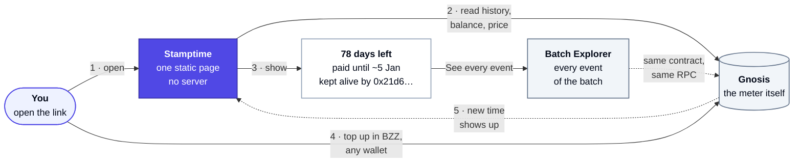
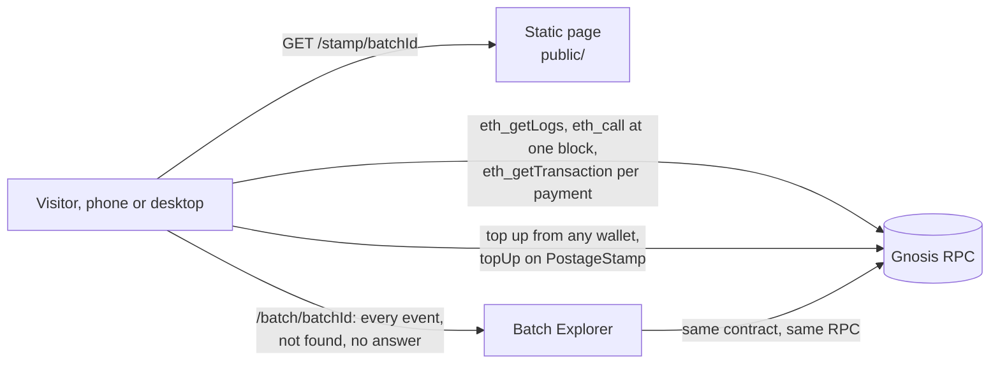

# Stamptime

A public page for one Swarm postage stamp. It answers one question for anyone who lands on it, **how long is this paid for?**, shows who has been keeping it alive, and offers a way for anyone to interact with the stamp.

Its ideal place is `ethswarm.org/stamp/<batchId>`, served by the Swarm Foundation as a service, for any stamp on the network. Any other place where Swarm's tooling is presented works just as well.

It stands on the great work of [Batch Explorer](https://batch-explorer.github.io/): the page borrows its look, and sends anyone who wants every event of a batch there.

<p>
  
  
</p>


---

## In one picture

A postage stamp is a parking meter for data on Swarm. Someone feeds it BZZ, it counts down one block at a time, and when it reaches zero the network stops keeping what it covers. Anyone can feed it, and whoever parked still owns the spot. Stamptime is the window on that meter: it reads the meter straight from the chain and shows how long is left and who has been feeding it.



---

## The short version

- **The page is done.** It lives in `public/`: one HTML file, one CSS file, the page script, a small QR encoder, the script that reads the chain and viem, vendored. No build step, no framework, no server.
- **It reads Gnosis itself.** `public/chain.js` reads the stamp from the PostageStamp contract in the browser, through a public RPC, the way Batch Explorer reads a batch, and builds one JSON document per stamp. `public/stamp.js` draws everything from that document: the bar, the ranking, the four states, what adding time would take, new time arriving.
- **All it needs is a place to serve `public/`:** any static host, Swarm itself, or a path such as `/stamp/{batchId}` on a site that already exists. See [Serving it](#serving-it).
- **An API is optional.** The document is [`api/stamp.schema.json`](api/stamp.schema.json), with one example per state in [`public/examples/`](public/examples/). A host that would rather serve it from a cache sets one meta tag and the page asks that API instead. [How to compute each field](#how-to-compute-each-field) has the arithmetic, with viem snippets.
- **A few decisions are still open** and are listed in [Open questions](#open-questions). None of them blocks starting.

If you read only one more section, read [How the page reads the chain](#how-the-page-reads-the-chain).

---

## See it running in one minute

```bash
git clone <this repo> && cd stamptime
python3 -m http.server 8080 --directory public
```

Then open a real stamp, read live from Gnosis: `http://localhost:8080/?id=<batchId>`. Or one of these demos, which read `public/examples/<name>.json` instead of the chain and show a bar to switch between states.

| URL | What you see |
|---|---|
| http://localhost:8080/?demo=active | A paid stamp, 73 days left, two keepers |
| http://localhost:8080/?demo=topped | The same stamp after someone added six months |
| http://localhost:8080/?demo=expiring | 9 days left, the pill turns amber |
| http://localhost:8080/?demo=expired | The balance ran out, Adding time is disabled |
| http://localhost:8080/?demo=not_found | An id that was never created |
| http://localhost:8080/?demo=loading | The page while it reads the stamp |
| http://localhost:8080/?demo=error | The RPC did not answer |

In the `active` demo, press **Adding time**: a month, half a year and a year open under the bar, and the bar hatches the one you pick, with the number and the date it would reach. Nothing leaves the page. Then press **After top up** in the demo bar to see time arrive: the new months add up one by one at the end of the bar and the new keeper rises to the top of the ranking.

Add `&bare=1` to hide the demo bar (that is how the screenshots above were taken).

---

## What the page shows, and where each number comes from

| On screen | JSON field | Source on chain |
|---|---|---|
| **73** days left | `expiry.time`, `chain.blockTime` | `remainingBalance(id) / lastPrice()` blocks, 5 s each |
| Paid until about **27 Dec 2026**, give or take 4 days | `expiry.time`, `expiry.earliest`, `expiry.latest` | same, with the lowest and highest price of the last 30 days |
| Pill: Paid, Expiring soon, Expired | `status`, plus the page rule "14 days or less" | `remainingBalance`, contract state, `BatchCreated` history |
| The bar: one block per month, from creation to the end | `created.time`, `expiry.*`, `chain.blockTime` | `BatchCreated` block time, the expiry above |
| Keepers ranking, days and BZZ per address | `contributions[]` | `BatchCreated` and every `BatchTopUp`, payer from the transaction |
| Adding time: ≈ 34.2 BZZ per stretch, and the date it would reach | `pricing.bzzPerDay`, `expiry.time` | `lastPrice()` and depth |
| Batch ID, with copy and a QR code beside it in the headline and in Stamp details; owner, depth, immutable | `batchId`, `owner`, `depth`, `immutable` | `BatchCreated`, `BatchDepthIncrease` |
| Storage capacity, 7.7 GB usable | `capacity` | effective volume table for the depth (not on chain) |
| Created 09/10/2026, #44108210 | `created.*` | `BatchCreated` log |
| Balance, 83.2 BZZ left on the stamp | `pricing.bzzPerDay` times the days from `chain.blockTime` to `expiry.time` | `remainingBalance(id)` x 2^depth / 1e16 |
| Storage price, 1.14 BZZ a day at this size | `pricing.bzzPerDay` | `lastPrice()` and depth |
| Block #44213870, balance read N s ago | `chain.block`, `chain.blockTime` | the block both reads were pinned to |
| Footer: RPC and contract | `chain.rpc`, `chain.contract` | your configuration |

BZZ is the unit of the page. The headline says the stamp is paid in BZZ, each keeper shows the BZZ they put on it, Stamp details show Balance and Storage price in BZZ so anyone can divide one by the other and get the expiry back, and Adding time shows each stretch in BZZ. The page shows no dollars, and never PLUR.

---

## Architecture



The only interface the page cares about is the JSON document. `public/chain.js` builds it in the browser; an API can serve it instead (see [The stamp document](#the-stamp-document)).

### How the page reads the chain

A first visit to an active stamp costs three requests to the RPC, about 50 KB compressed, since calls made together go out as one JSON-RPC batch: the block, then everything that only needs the block, then everything that needs the batch's history. The stamp shows once the second has answered; the third fills in who kept it alive and the range. Each re read while the page stays open costs two.

| What | How | Calls | Request |
|---|---|---|---|
| The block | `eth_getBlockByNumber`, the latest. Every live value is read at it | 1 | 1st |
| The batch's history | One `eth_getLogs` on PostageStamp filtered by batch id, from the deployment block. The Gnosis RPC answers it in one go, as it does for Batch Explorer, with each log's block time | 1 | 2nd |
| What is left | `currentTotalOutPayment()` and `lastPrice()`, both at the block just read. What is left per chunk is the batch's last `normalisedBalance` minus that total, so a batch the contract has already removed still reads | 2 | 2nd |
| The range, sampled | `PriceUpdate` events of one round in 53 over the last 30 days (a round has one, unless the oracle skipped it), and every block after the last of them | about 66 | 2nd |
| The range, where it lies | For an active stamp only, read whole: where the 30 days start, and the stretches beside the three highest and three lowest samples | about 8 | 3rd |
| The days each payment bought | The `PriceUpdate` in force at its block, from a window of 2,000 blocks before it | 1 per payment | 3rd, and one more per 24 payments |
| Who paid | `eth_getTransactionByHash`, since `BatchTopUp` carries no payer | 1 per payment | 3rd, and one more per 24 payments |
| When an expired batch ran out | The price history walked from its creation or from today, whichever is closer, in windows sized by a guess at how far (step 4 below) | 1 to a dozen, once | 4th on |

**The range** is the lowest and the highest price of the last 30 days. All of them is about 3,300 `PriceUpdate` events, 1.6 MB of JSON and 300 KB compressed, more than the rest of the page together; it used to be one read, which on a slow 3G link could not finish within the page's timeout. The price changes at most once a round of 152 blocks, by at most 0.08%, so its lowest and highest points lie next to the lowest and highest of a few samples, or at the ends of the 30 days when it trends. `chain.js` reads those samples, then reads whole only the stretches where the lowest and highest can lie, passing over samples whose round had no update, since the oracle sometimes skips dozens of rounds (section 4 of `chain.js`): about 500 events instead of 3,300. Replayed every 3 hours over 430 days of real prices, it found the same lowest and highest price as reading all of them at 2,580 of 2,581 heads; the other moved an end of the range by 50 minutes, and the "give or take" shown, for stamps with 9 to 730 days left, was the same at every head.

What cannot change (who paid, past prices, block times, when a batch ran out, the samples and stretches of the range) is kept for the life of the tab, and the event lists fetch only what is new. Nothing needs an archive node.

**Load.** Every visitor reads the chain on their own, as on Batch Explorer, and a link shared widely sends that traffic to the RPCs in `stamptime-rpc`. The page uses the first that answers and falls back to the next, so one node down or rate limited does not take it down. Add a node of your own to the list, or set `stamptime-api` and serve the document from a cache.

**viem.** Version 2.47.6, the one Batch Explorer uses, is vendored as `public/vendor/viem.js`: 46 KB, 15 KB compressed, built from [`tools/viem.entry.js`](tools/viem.entry.js), which says how to build it again. It holds the client and its http transport, the ABI decoders and the address checksum, and none of viem's actions: `chain.js` sends its few calls itself, since `readContract` alone would add 63 KB. `chain.js` and viem load only when a real stamp is asked for, at the same time, so the demo never touches the chain.

---

## The stamp document

One JSON document per stamp, between reading and drawing. `chain.js` builds it; an API that serves it is optional, at:

```
GET /api/v1/stamps/{batchId}
```

With `<meta name="stamptime-api" content="/api/v1">` in `index.html`, the page asks that instead of the chain. For such an API:

- `batchId`: 64 hex characters, with or without `0x`, any case. Normalise to lower case without `0x` in the response.
- Always answer **200** with a JSON body, including for a stamp that does not exist (`{"batchId": "<the id>", "status": "not_found"}`). The page also accepts a 404 with that same body, but any other 404 is treated as "the API is not where I expected", which shows the error state, not "no stamp".
- The page checks each document against this contract before drawing it. One that does not match the schema, or carries another `batchId` than the one asked for, shows the error state, with the reason in the browser console.
- `400` for a malformed id. The page validates the id before calling, so this should not happen from the page.
- Headers: `Content-Type: application/json`, `Access-Control-Allow-Origin: *` (the badge will call it from other sites), `Cache-Control: public, max-age=15`.

Keep the cache short, so time someone adds shows up on the page's next read.

### Statuses

| `status` | Meaning | What the page does |
|---|---|---|
| `active` | The batch has balance left | Number, bar, ranking, Adding time enabled. Shows "Expiring soon" when 14 days or less remain (page rule) |
| `expired` | A `BatchCreated` exists for this id, but the balance is zero or the batch was removed from state | Muted bar, "Ran out around …", Adding time disabled, ranking kept as a record |
| `not_found` | No `BatchCreated` was ever emitted for this id on the current PostageStamp | "No stamp with this id", link to Batch Explorer |

### Fields

The full schema with descriptions is [`api/stamp.schema.json`](api/stamp.schema.json). Here is [`public/examples/active.json`](public/examples/active.json):

```json
{
  "batchId": "c4f1a09e2b7d4c1e8f3a6b2d9c0e1f4a5b6c7d8e9f0a1b2c3d4e5f6a7b8c7e2d",
  "status": "active",
  "chain": {
    "id": 100,
    "contract": "0x45a1502382541Cd610CC9068e88727426b696293",
    "rpc": "rpc.gnosis.gateway.fm",
    "block": 44213870,
    "blockTime": "2026-10-15T12:00:00Z"
  },
  "owner": "0x1F3a5c0E7b2D4a9f8E6c1B3d5F7a9C0e2B4d9bC4",
  "depth": 22,
  "immutable": true,
  "capacity": "7.7 GB",
  "created": { "time": "2026-10-09T09:14:25Z", "block": 44108210, "tx": "0xe062…eaca1" },
  "expiry": {
    "time": "2026-12-27T12:00:00Z",
    "earliest": "2026-12-23T12:00:00Z",
    "latest": "2026-12-31T12:00:00Z",
    "lastBlock": null
  },
  "pricing": { "bzzPerDay": 1.14, "usdPerDay": 0.0456 },
  "contributions": [
    { "kind": "created", "address": "0x1F3a…9bC4", "time": "2026-10-09T09:14:25Z", "block": 44108210, "tx": "0xe062…", "days": 53, "usd": 2.5 },
    { "kind": "topup",   "address": "0x8b4E…41e2", "time": "2026-10-12T17:41:05Z", "block": 44166123, "tx": "0x77e7…", "days": 26, "usd": 1.2 }
  ]
}
```

(Hashes and addresses shortened here; the files have them in full. The example values are illustrative, the contract address is the real one.)

| Field | Notes |
|---|---|
| `chain.block`, `chain.blockTime` | Pin **both** live reads (`remainingBalance` and `lastPrice`) to the same block, and send that block's timestamp. The page uses `blockTime` as "now". |
| `owner` | The batch owner. The ranking labels this address **Owner**, whoever paid for the `BatchCreated`. |
| `expiry.time` | Most likely end, always present for `active`. For `expired`, when it ran out, or `null` if you cannot reconstruct it. |
| `expiry.earliest`, `expiry.latest` | The range shown as "give or take". `null` when expired. The page also fades the end of the bar across it. |
| `pricing.bzzPerDay` | Cost of one more day for the whole stamp at today's price, in BZZ. From the chain alone. Shown in Stamp details as the Storage price and, times the days left, as the Balance, and in Adding time. |
| `pricing.usdPerDay` | The same in USD, or `null`. The page does not show dollars, and `chain.js` leaves it `null` when the page reads the chain. |
| `contributions[]` | One entry per event that paid for time, oldest first: the `BatchCreated`, then each `BatchTopUp`. Do not group them. The page groups by address into keepers. |
| `contributions[].days` | Days of storage that payment bought, at the price in force at its block. Fractions are fine. |
| `contributions[].usd` | Value of that payment at the time, or `null`. Not shown by the page. |
| `contributions[].bzz` | BZZ that payment put on the stamp (the event amount divided by 1e16), or `null`. Shown as a chip next to the keeper's days. |

---

## How to compute each field

`public/chain.js` does all of this in the browser. This section is the reference for it, and for an API if one is ever built.

### Constants

| | |
|---|---|
| Chain | Gnosis, chain id `100` |
| PostageStamp contract | `0x45a1502382541Cd610CC9068e88727426b696293` (the one Batch Explorer reads today; confirm before shipping) |
| Block time | 5 seconds, so 17,280 blocks a day |
| Price unit | PLUR per chunk per block. `lastPrice()` on PostageStamp, or `currentPrice()` on PriceOracle |
| Price changes | At most once per round of 152 blocks (about 12.7 minutes), emitted as `PriceUpdate(price)` by PostageStamp |
| PLUR per BZZ | 1e16 |
| Chunks in a batch | `2 ** depth` |

Sources: [PostageStamp.sol](https://github.com/ethersphere/storage-incentives/blob/master/src/PostageStamp.sol), [PriceOracle.sol](https://github.com/ethersphere/storage-incentives/blob/master/src/PriceOracle.sol), [Postage stamp batches in the docs](https://docs.ethswarm.org/docs/develop/tools-and-features/buy-a-stamp-batch).

### ABI you need

```ts
import { createPublicClient, http, parseAbi, parseAbiItem } from 'viem'
import { gnosis } from 'viem/chains'

export const POSTAGE_STAMP = '0x45a1502382541Cd610CC9068e88727426b696293'

export const abi = parseAbi([
  'function remainingBalance(bytes32 batchId) view returns (uint256)',
  'function lastPrice() view returns (uint64)',
  'function currentTotalOutPayment() view returns (uint256)',
])
export const BatchCreated = parseAbiItem('event BatchCreated(bytes32 indexed batchId, uint256 totalAmount, uint256 normalisedBalance, address owner, uint8 depth, uint8 bucketDepth, bool immutableFlag)')
export const BatchTopUp = parseAbiItem('event BatchTopUp(bytes32 indexed batchId, uint256 topupAmount, uint256 normalisedBalance)')
export const BatchDepthIncrease = parseAbiItem('event BatchDepthIncrease(bytes32 indexed batchId, uint8 newDepth, uint256 normalisedBalance)')
export const PriceUpdate = parseAbiItem('event PriceUpdate(uint256 price)')

export const client = createPublicClient({ chain: gnosis, transport: http('https://rpc.gnosis.gateway.fm') })
```

The contract also exposes the batch struct through its `batches(bytes32)` mapping (`owner, depth, bucketDepth, immutableFlag, normalisedBalance, lastUpdatedBlockNumber`). Check the exact getter in the verified ABI on Gnosisscan if you want it; everything below works from events alone.

### 1. The live part: expiry and range

```ts
const id = `0x${batchId}` as const
const block = await client.getBlock()                         // pin both reads to one block
const at = { blockNumber: block.number }

let remaining: bigint
try {
  remaining = await client.readContract({ address: POSTAGE_STAMP, abi, functionName: 'remainingBalance', args: [id], ...at })
} catch {
  remaining = 0n                                              // removed from state: see step 4
}
const price = await client.readContract({ address: POSTAGE_STAMP, abi, functionName: 'lastPrice', ...at })

const secondsLeft = Number(remaining / price) * 5
const expiry = new Date((Number(block.timestamp) + secondsLeft) * 1000)
```

For the range, take the lowest and highest `PriceUpdate` price of the last 30 days (about 518,400 blocks; one `eth_getLogs` of about 3,300 events, or sampled as `chain.js` does, see [How the page reads the chain](#how-the-page-reads-the-chain)):

```ts
const earliest = Number(block.timestamp) + Number(remaining / maxPrice30d) * 5   // price up, ends sooner
const latest   = Number(block.timestamp) + Number(remaining / minPrice30d) * 5   // price down, lasts longer
```

If you do not have the history yet, a fixed band of plus or minus 5 % of the time left is an acceptable first version. Say so in a comment; the page copy says "the range uses the lowest and highest price of the last 30 days", so update that sentence in `index.html` if you ship the band.

### 2. The history: created and contributions

Read these PostageStamp events from the contract's deployment block, filtered by `batchId` where the event has it:

- `BatchCreated`: owner, depth, bucket depth, immutable flag, `totalAmount`.
- `BatchTopUp`: `topupAmount`.
- `BatchDepthIncrease`: new depth (a dilution).
- `PriceUpdate`: the price history, needed for every `days` value and for the range.

Then, per event:

```ts
// price in force at a block: the last PriceUpdate at or before it
// depth at a block: from BatchCreated, then any BatchDepthIncrease before it
const perChunk = amount / (1n << BigInt(depthAt(log.blockNumber)))     // totalAmount or topupAmount
const blocks = perChunk / priceAt(log.blockNumber)
const days = Number(blocks) * 5 / 86400

const tx = await client.getTransaction({ hash: log.transactionHash })   // BatchTopUp has no payer field
const address = tx.from
```

`totalAmount` in `BatchCreated` and `topupAmount` in `BatchTopUp` are both totals for the whole batch (per chunk amount times `2 ** depth`), in PLUR. `usd` is that amount divided by 1e16, times the BZZ to USD rate at the time.

**Log ranges.** Both RPCs in `stamptime-rpc` answer `eth_getLogs` filtered by batch id from the deployment block in one request, as `rpc.gnosis.gateway.fm` does for Batch Explorer, and 30 days of `PriceUpdate` in another, and both take JSON-RPC batches. Many public RPCs cap ranges (to 50,000 or 10,000 blocks on the free tiers tried): read in windows then (10,000 blocks is a safe start), and follow the head rather than reading the history again.

### 3. Pricing

```ts
const bzzPerDay = Number(price) * 2 ** depth * 17280 / 1e16   // PLUR per chunk per block, times chunks, times blocks a day
const usdPerDay = bzzUsd == null ? null : bzzPerDay * bzzUsd
```

### 4. Status, and expired versus never existed

| Situation | How to tell | `status` |
|---|---|---|
| Balance left | `remainingBalance > 0` | `active` |
| Ran out, still in state | `remainingBalance == 0` | `expired` |
| Ran out and removed by `expireLimited` | the read reverts or the owner is zero, **and** you have its `BatchCreated` | `expired` |
| Never existed | no `BatchCreated` for this id | `not_found` |

The contract cannot tell the last two apart on its own; the batch's events can. For `expired`, reconstruct `expiry.time` and `expiry.lastBlock` as the first block where `currentTotalOutPayment()` reached the batch's last `normalisedBalance`. That total grows by the price in force each block, so the `PriceUpdate` history gives it back, walked from either end: back from today, where it has run past the balance by a known amount, or forward from the creation, where `BatchCreated` pins it exactly (its `normalisedBalance` minus `totalAmount / 2 ** depth`). `chain.js` starts from the end that looks closer, tries the other if that fails, reads the history in windows sized by a guess at how far it has to go, and gives up after six months of history from each; an archive node could binary search the view instead. If neither works, send `null`; the page then says "Ran out" without a date.

### 5. Capacity

Send a label such as `"7.7 GB"`. Take it from the effective volume table in the Swarm docs for the batch's depth (`chain.js` carries the unencrypted table without erasure coding). Do not send `2 ** depth * 4 KB`: that is the theoretical maximum and it overstates what fits.

---

## What the page does on its own

This is all in `public/stamp.js`, and it explains how often the page reads the stamp.

- **On load:** one read of the stamp. While it waits, a skeleton with the batch id from the address (to copy, or to look up on Batch Explorer) and the step the read is on. As soon as the balance is read the stamp shows: the number, the sentence, the bar and Stamp details; who kept it alive and the "give or take" fill in when the rest of the read arrives, about a round trip later. A visitor who saw the stamp before, and to whom time was added since, sees that earlier version at that moment instead, and the new time arrives on it. A read that has shown nothing after 10 s shows the error state, with a retry.
- **While open:** it ticks the block number every 5 s locally, and reads the stamp again once per price round (760 s).
- **Adding time:** opens under the bar, in the same card: a month, half a year and a year side by side, each priced in BZZ from `pricing.bzzPerDay` and dated from `expiry.time`. The one picked is hatched on the bar from the paid end, the bar takes in the months it needs, the number shows the days it would reach and the sentence the date, and a dashed Preview pill, whose swatch is the hatching, says what it is. Where there is a hover, pointing at a stretch draws it. Close, Escape or the tile again put the bar back. It is a preview: nothing is paid, signed or sent from the page.
- **New time arriving:** whenever a render brings contributions that were not on screen before (on the periodic re read, or on a reload), the page plays one short sequence instead of jumping. The number counts up to the new total, the months already on the bar narrow to make room as the new months widen in at the end, one after another, and the new keeper appears on the open slot it took and rises over the list to its rank as a card, while the other rows slide down. With reduced motion it only fades the new row in.
- **What changed since your last visit:** the page keeps the last version of each stamp it showed in `localStorage`, only to know what is new on a reload. It shows that version for half a second, then plays the sequence above with a short note ("Since you last looked, 181 days were added"). Nothing leaves the browser, and without storage the page simply shows the current state. In the demo, open `?demo=active` and then `?demo=topped` to see it.
- **Expiring soon:** the page shows it at 14 days or less. It is not a status in the document.
- **Ranking:** groups `contributions` by address, sums days and BZZ, sorts by days given. The row of the `owner` address is labelled Owner, whoever paid for `BatchCreated` ("Owner, created the stamp" when it was the owner); a creator who is not the owner reads "Created the stamp". While the stamp is paid there is an open slot at the end that states the rule: "Any address can add BZZ to it. The owner stays the owner."
- **The record:** the page shows what the stamp holds, who kept it alive and what adding time would take. The tiles are Adding time, See every event, Read the contract and How postage works (the Swarm docs), and the footer carries the ASCI line. It does not add time, hold funds or sell anything.
- **Configuration** lives in a meta tag in `index.html`, and a second when an API serves the stamp. `stamptime-rpc` lists the Gnosis RPCs the page reads from, separated by spaces: it uses the first that answers and stays with it. `stamptime-api`, when present, replaces them (see [The stamp document](#the-stamp-document)).

```html
<meta name="stamptime-rpc" content="https://rpc.gnosis.gateway.fm https://rpc.gnosischain.com">
<!-- optional: <meta name="stamptime-api" content="/api/v1"> -->
```

`index.html` also sets a Content-Security-Policy that runs only scripts from the page's own origin (`script-src 'self'`), so no inline script or markup in the data can run. `chain.js` and `vendor/viem.js` are served from that origin too. If your host injects scripts of its own, add their origin there, or a hash of the script for an inline one.

---

## Serving it

**The page.** Serve the contents of `public/` under `/stamp/`, and send every `/stamp/{batchId}` to `index.html`. Assets are referenced relatively (`./stamp.css`, `./stamp.js`), so they must sit next to `index.html` under `/stamp/`, and `/stamp/{batchId}/` with a trailing slash must redirect to `/stamp/{batchId}`. The page reads the id from `?id=` when present, which works on any static host, and otherwise from the last path segment.

With nginx, assuming `public/` is deployed as `/srv/stamptime/stamp/`:

```nginx
location /stamp/ {
  root /srv/stamptime;
  rewrite ^(/stamp/[^/]+)/$ $1 permanent;
  try_files $uri /stamp/index.html;
}
```

On Swarm itself, upload `public/` as a website with `index.html` as both the index and the error document, so unknown paths fall back to the page. Since the page reads the chain itself, that is all it needs: no server anywhere.

**The RPCs.** Any Gnosis JSON-RPC that allows browser requests (CORS) and `eth_getLogs` over the batch's history, listed in `stamptime-rpc` in the order to try them. The defaults are the one Batch Explorer uses, `rpc.gnosis.gateway.fm`, then Gnosis's own, `rpc.gnosischain.com`. If one fails partway through a read, the whole read is done again on the next, so the footer always names the RPC the page shows.

**An API, if you want one.** Wherever you like, as long as `stamptime-api` in `index.html` points at it. Same origin is simplest. Keep CORS open for the badge.

**Fonts.** Roboto, the font Batch Explorer loads from Google Fonts, is served with the page from `public/fonts/`: one 25 KB file for the three weights, cut to the characters the page shows, made by [`tools/roboto.sh`](tools/roboto.sh), under the SIL Open Font License (`public/fonts/OFL.txt`). The page loads no stylesheet or font from another origin, and shows the system font until the file arrives, or if it fails.

---

## Product rules

These came out of the research and the design rounds. Please keep them when you touch copy or add fields.

1. **BZZ is the unit.** The headline says the stamp is paid in BZZ; each keeper shows the BZZ they put on it; Stamp details show Balance and Storage price in BZZ, so balance divided by price can be checked against the expiry; Adding time shows each stretch in BZZ. No dollars, and never PLUR.
2. **The end is an estimate.** Always "about" a date, with a range. Never a fixed date or a countdown in hours.
3. **No promises the chain cannot back.** No "forever", no node counts, no SLA. The pill says **Paid**, not "Alive" or "Operational": the chain proves payment, not serving.
4. **Adding time extends the whole stamp, for everyone.** Anyone can do it, and it does not change the owner.
5. **No wallet, account or cookie.** The page never asks for a wallet. Nothing leaves the browser: it keeps the last version of each stamp shown, to animate what changed.
6. **No fill level.** Batch utilisation is not on chain, so the page does not show how full a stamp is.
7. **Batch Explorer is the pro view.** The page links to it for every event and does not try to replace it.
8. **The page is agnostic.** It is a Swarm page about a stamp. It never names or brands what is stored in it.
9. **The page is the record.** It explains the stamp (days, keepers, details, how time is added) and previews what adding time would take. It does not add time, hold funds or sell anything.

---

## Open questions

| # | Question | Why it matters |
|---|---|---|
| 1 | Who signs the `topUp` transaction when someone pays with another token or from another chain? | If top ups are executed from a shared relayer address, `tx.from` is the relayer for everyone and the ranking becomes one row. Those rows would need the original payer, or a "via relayer" label. |
| 2 | Are public RPCs enough for a link shared widely? | Every visitor reads the chain, as on Batch Explorer, from their own browser. The two defaults answer every read the page needs and back each other up. Their rate limits are not known yet; check them before a big launch. A busy link may want its own node at the top of `stamptime-rpc`. No archive node is needed. |
| 3 | Price range: 30 day history or a fixed band for v1? | Settled: `chain.js` reads the 30 day history in one request. |
| 4 | Badge script (`ethswarm.org/stamp/badge.js`) | The page already shows the embed line. The badge needs only the stamp document, from `chain.js` or an API. Not needed for a first release. |
| 5 | Batches copied from an older PostageStamp deployment | Their `BatchCreated` on the current contract may be the copy, not the original purchase, so "Created" could show the migration date. Fine for v1; worth a look. |

---

## Edge cases to test

- [ ] Malformed id in the URL, given with `?id=` or as a path segment that looks like a hash: the page shows "No stamp with this id" without reading the chain. A trailing `.` or `)` picked up when the link was pasted is ignored.
- [ ] An id that never existed: `"status": "not_found"`.
- [ ] A batch that ran out but is still in state: `expired`, with `expiry.time`.
- [ ] A batch that ran out and was removed: `expired`, from the event history.
- [ ] A diluted batch (`BatchDepthIncrease`): `depth`, `capacity`, `bzzPerDay` and `usdPerDay` use the current depth; past `days` use the depth at their block.
- [ ] A batch with many top ups from the same address: one row on the page, days summed.
- [ ] A one or two day batch (common on Swarm): one block on the bar, mostly fade. Looks right.
- [ ] A five year batch: about sixty thin blocks. Readable on desktop, a texture on a phone. Acceptable for v1.
- [ ] First RPC down or unreachable: the page reads through the next one, and the footer names it.
- [ ] Every RPC down: the page shows "Could not read the stamp" with a retry.

---

## Repository layout

```
stamptime/
  README.md                  this file
  LICENSE                    Apache 2.0
  api/
    stamp.schema.json        the stamp document, as chain.js builds it and an API would serve it
  public/                    deploy this folder as /stamp/
    index.html               markup and the config meta tags
    stamp.css                Batch Explorer's look: Roboto, slate, one indigo
    stamp.js                 all page behaviour, commented
    chain.js                 reads a stamp from Gnosis and builds its document
    qr.js                    draws the batch id as a QR code, no dependencies
    fonts/
      roboto.woff2           Roboto 400 to 700, the characters the page shows (generated)
      OFL.txt                its license
    vendor/
      viem.js                viem 2.47.6, the parts chain.js uses (generated)
    examples/                one JSON per state, used by ?demo= and as fixtures
      active.json
      expiring.json
      topped.json
      expired.json
      not_found.json
  tools/
    viem.entry.js            what goes into vendor/viem.js, and how to build it again
    roboto.sh                how fonts/roboto.woff2 is cut from Roboto
  docs/                      screenshots for this README
```

---

## Definition of done

- [ ] The page reads active, expired and not found batches from Gnosis, and each document it builds matches `api/stamp.schema.json`.
- [ ] Both live values are read at one pinned block, and `chain.blockTime` is that block's time.
- [ ] A host serves the page, at `/stamp/{id}` or with `?id=`, and `?demo=active` still works there.
- [ ] The RPCs in `stamptime-rpc` hold up under a link shared widely, or a node of its own goes first in the list.
- [ ] Tested on a phone on a slow connection.

## License

[Apache License 2.0](LICENSE), the same as Batch Explorer.
